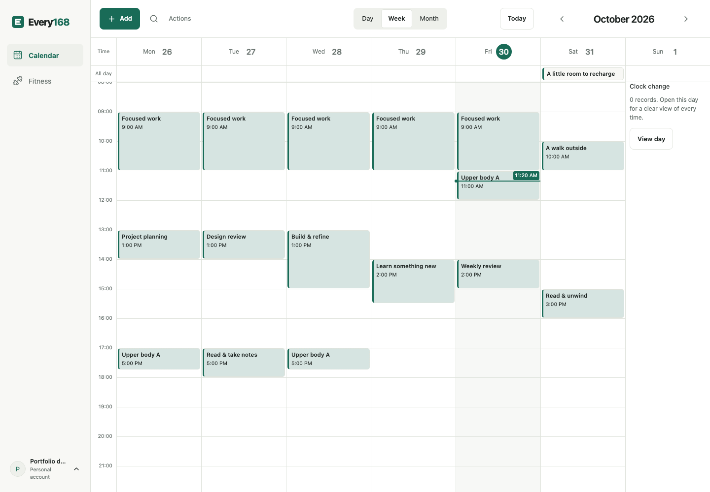
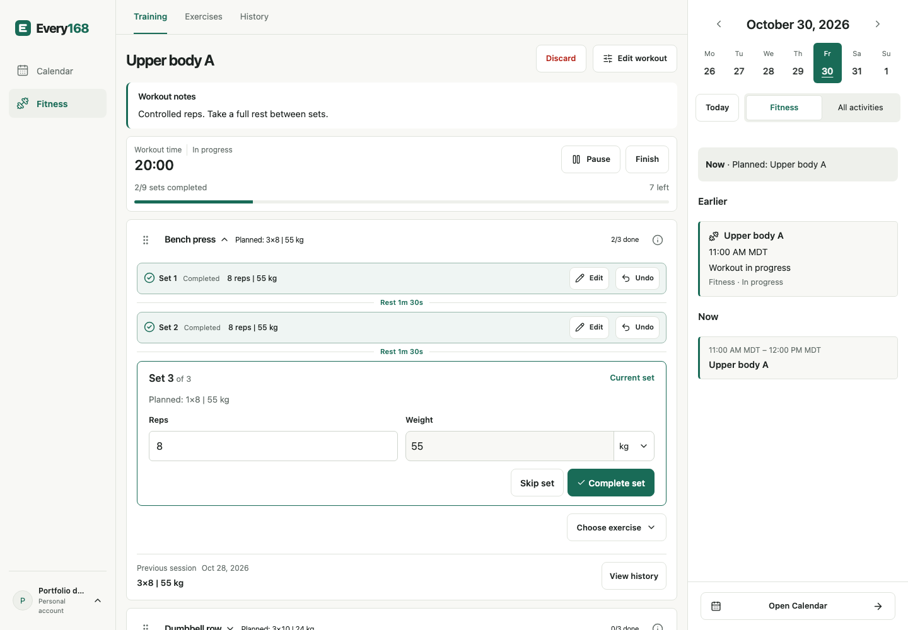
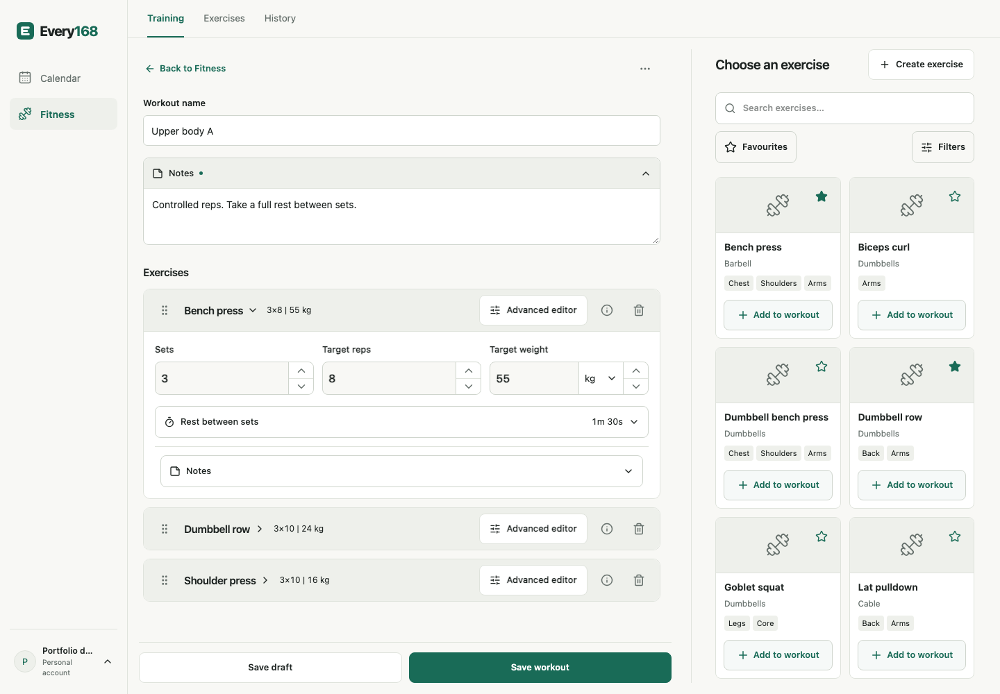
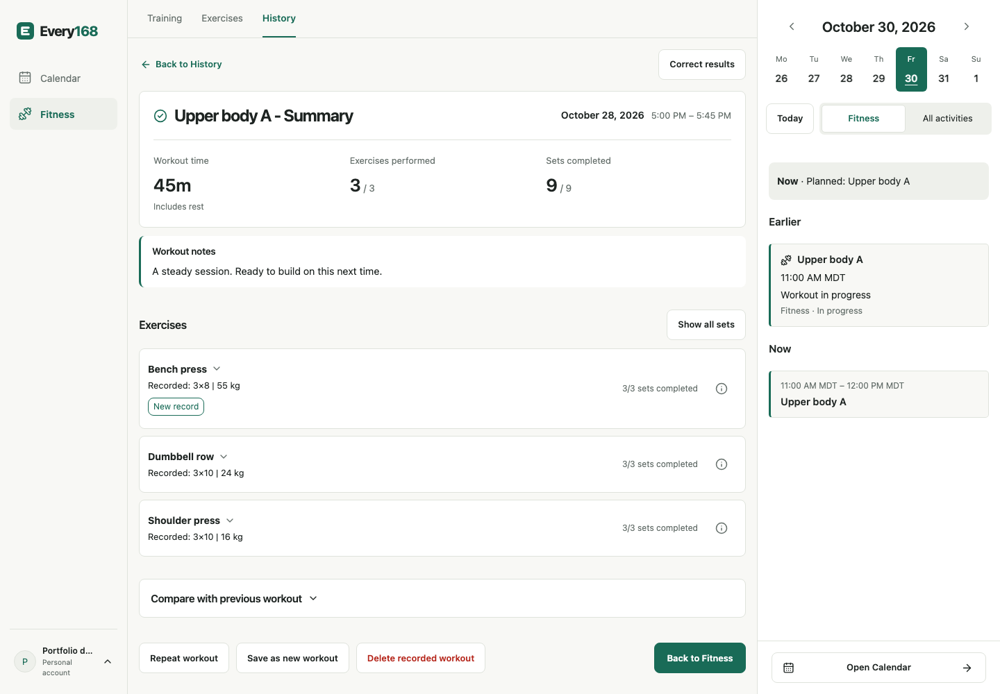
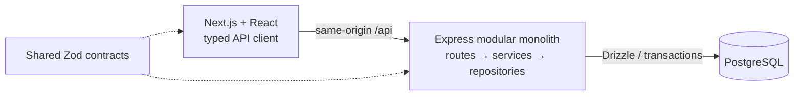

# Every168


**Plan your week. Record your training. Review what actually happened.**

Every168 is a full-stack Calendar and Fitness web application that connects weekly planning with detailed workout logging. Scheduled time, reusable workouts and recorded sessions stay separate, so a plan never silently becomes a completed activity.

**Status:** open-source portfolio project under MIT; no hosted deployment. The screenshots below are genuine application captures using synthetic data.

<p>
  <a href="docs/media/screenshots/calendar-week.png"></a>
  <a href="docs/media/screenshots/live-workout.png"></a>
</p>

Calendar planning and live workout logging. Open either image for the full-size capture.

## What it does

- **Calendar:** Day, Week and Month views; timed and all-day plans; finite daily/weekly repetition; drag, resize, copy/paste, search, and Undo/Redo. Dates follow the account's timezone and week-start preference.
- **Fitness:** a curated exercise library and custom exercises, reusable workout drafts, Basic/Advanced set editing, live set logging, rest timers, pause/resume, completed summaries and explicit result corrections.
- **Connected review:** schedule a workout into Calendar, start it from its reservation, then review its actual results in History. Exercise records and previous-workout comparisons derive from completed sets; editing a reusable workout does not rewrite old sessions.

<details>
<summary><strong>Prepare and review a workout</strong></summary>

### Prepare



### Review



More views, including Month, plan editing, the library, exercise history and a responsive layout, are in the [screenshot gallery](docs/media/README.md).

</details>

## How it is engineered



| Layer                  | Implementation                                                                           |
| ---------------------- | ---------------------------------------------------------------------------------------- |
| Web                    | Next.js App Router, React, TanStack Query, React Hook Form                               |
| API                    | Node.js, Express 5, TypeScript in strict mode                                            |
| Data                   | PostgreSQL, Drizzle ORM and versioned SQL migrations                                     |
| Contracts and identity | Shared Zod schemas, typed API client, Better Auth database-backed sessions               |
| Verification           | Vitest, Supertest with real PostgreSQL, Playwright, axe checks and import-boundary tests |

Selected decisions:

- **Modules without distributed systems.** Domain services own business rules; repositories own persistence. Cross-domain work uses public services, and automated checks enforce those boundaries. Next.js never imports API persistence.
- **Safe retries and concurrent edits.** Expected revisions reject stale changes. Idempotency receipts commit with their effects; interrupted writes retain their exact request key and payload for retry.
- **Local dates, exact instants.** Timezone-aware week boundaries handle DST. Unchanged saved timestamps retain their precision and offset through repeated-hour edits.
- **History that preserves meaning.** Planned targets are distinct from completed results. Missing measurements remain unknown, and derived records recalculate after corrections or deletion.
- **Private by account.** Reads, writes and reference lookups are owner-scoped. Verification/reset tokens expire and work once; credential changes revoke sessions. These protections have local regression coverage, not a public-security certification.

The [case study](docs/PORTFOLIO_CASE_STUDY.md) explains the tradeoffs and the failure cases behind these decisions.

## Run locally

Clone the Every168 repository below. Private `@168hours/*` workspace packages retain their internal names for compatibility. See the [brand guide](docs/BRAND.md) for identity and compatibility decisions.

Requires Node.js **22.12+** (CI uses **24 LTS**), **pnpm 9.15.9**, and Docker Compose.

```bash
git clone https://github.com/FrozenOJuice/Every168.git
cd Every168
pnpm install --frozen-lockfile
pnpm setup:env
pnpm db:up
pnpm db:migrate
pnpm db:provision
```

Local development temporarily allows sign-in without email verification; no Resend credentials are needed. Create an account, then sign in. Verification remains required in test/production, and real verification/reset emails need a configured Resend key and verified sender. Run:

```bash
pnpm dev
```

Open **http://localhost:3000**. Configuration, ports, local database roles and troubleshooting are covered in the [local-development guide](docs/LOCAL_DEVELOPMENT.md).

### Provider-free portfolio demo

The isolated capture harness uses the existing test database and in-memory email delivery. It creates synthetic records through the real API and opens the actual application; it does not bypass authentication in the ordinary development server.

```bash
pnpm exec playwright install chromium
PORTFOLIO_PAUSE=1 pnpm portfolio:capture --headed
```

After capturing the gallery, Playwright pauses with the populated application open for exploration or a recording. Resume in its inspector to finish and stop the test servers. To regenerate screenshots without pausing, run `pnpm portfolio:capture`.

## Testing and quality

```bash
pnpm lint
pnpm format:check
pnpm typecheck
pnpm test
pnpm test:integration
pnpm test:e2e:beta
pnpm build
```

Browser checks require Chromium (`pnpm exec playwright install chromium`) and the separate test database; run database/browser suites sequentially.

`pnpm verify:beta` runs the ordered Calendar/Fitness verification gate, including formatting and a production dependency scan. The command name is retained from the earlier release-preparation work; it does not deploy anything. The [GitHub Actions workflow](.github/workflows/ci.yml) runs on pushes to `main`, pull requests targeting `main` and manual dispatch. A Quality job checks lint/import boundaries, formatting, types, unit/architecture tests and production dependencies. A separate job runs integration tests, a production build and the beta browser suite sequentially against isolated PostgreSQL 18. Both use Node.js 24 LTS and pnpm 9.15.9; no real credentials or email provider are needed. Failed runs retain command logs and available Playwright reports, traces and screenshots for seven days.

Coverage includes two-account isolation, real PostgreSQL transactions, DST boundaries, interrupted-response recovery, concurrent workout corrections, keyboard/focus behavior and responsive layouts. See the [verification guide](docs/verification.md) for commands and the [dated remediation report](docs/FIRST_RELEASE_REMEDIATION.md) for recorded results and limitations. Test counts are evidence from those runs, not continuously updated badges.

## Status and limits

Calendar, Fitness, authentication and settings are the presented scope. Goals, Routines, Templates, Training Programs, Tasks, Food and Assistant remain in the repository behind explicit `preview` scope. They are not part of this showcase.

Exercise illustrations and a larger catalogue are deferred; the current interface uses visible placeholders. Recovery is scoped to the browser tab, not offline or cross-device synchronization. Physical-device Safari and screen-reader acceptance are not established by Chromium automation. Public hosting, real delivery acceptance and operational backup/restore verification are deferred.

## Technical documentation

- [Documentation index](docs/README.md)
- [Portfolio case study](docs/PORTFOLIO_CASE_STUDY.md)
- [Brand identity and retained identifiers](docs/BRAND.md)
- [Implemented architecture](docs/architecture.md)
- [Authentication and authorization](docs/security.md)
- [Verification guide](docs/verification.md)
- [Architecture decisions](docs/decisions/)

## License

[MIT](LICENSE). Third-party dependencies retain their licenses. The [screenshot provenance and icon notices](docs/media/README.md#provenance-and-licensing) document the visual assets shown here; future artwork needs its own rights review. The [publication and licensing review](docs/PUBLICATION_REVIEW.md) records the dependency inventory, safety findings and verification results.
