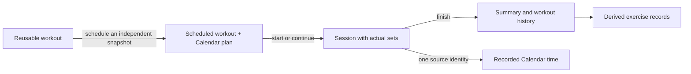

# Every168: connecting a plan to a reliable record

Every168 combines a weekly Calendar with a detailed Fitness workspace. The useful question is not just “What did I schedule?” but “What actually happened, and can I trust that record later?”

This is a working local portfolio application, not a hosted service. The presented scope is Calendar, Fitness, account access and settings. Broader modules are retained behind preview flags; AI, native clients and external calendar synchronization are not implemented.

## The problem

A calendar is good at reserving time but poor at recording individual workout sets. A workout log has the opposite strengths. Treating a scheduled workout as a completed workout creates misleading history; copying its results into a separate time tracker creates opportunities for duplication and drift.

Every168 keeps three useful objects separate: a reusable workout definition, a scheduled snapshot linked to a Calendar reservation, and a session containing actual results. Starting from the reservation follows an explicit link, not a title match. Finishing or correcting a session updates its single recorded-time source transactionally. Removing a reservation does not erase the session.

## Decisions that matter

### One backend with enforceable module boundaries

Next.js presents the UI and uses a framework-neutral typed API client. Express handles transport, authentication and validation. Domain services own use cases, repositories own Drizzle/PostgreSQL persistence, and cross-domain collaboration goes through public services.

This makes it possible for Fitness to reserve Calendar time without writing Planning tables directly. It also avoids the deployment and distributed-transaction costs of microservices. Import-boundary checks and architecture regression tests enforce the rule; the diagram is not the only evidence of separation.

Explore: [composition](../apps/api/src/composition.ts), [boundary checker](../scripts/check-boundaries.mjs), [shared contracts](../packages/contracts/src/index.ts), [architecture](architecture.md).

### A retry must mean the same intent

If a save commits but its response disappears, a new request can accidentally create a second record. Writes therefore carry an idempotency key and an expected revision. The receipt and effects commit in one transaction; replaying the same confirmed request returns its original result. Reusing the key for different input is rejected.

The browser retains the exact pending payload, revision and key in account-specific tab storage before sending supported Calendar/Fitness writes. Recovery confirms that request rather than inventing a new one after refresh. Undo/Redo retains its own inverse-command state. A stale external edit still causes a revision conflict; recovery does not silently overwrite newer data.

Tradeoff: this is same-tab recovery, not an offline synchronization system. Storage failure can prevent sending a write. Those limitations are explicit in the interface and documentation.

Explore: [write-integrity decision](decisions/003-write-integrity.md), [Calendar recovery](../apps/web/src/features/planning/calendar-write-recovery.ts), [interrupted-write browser regression](../tests/e2e/calendar-reliability.spec.ts).

### Local calendar time is not a sequence of 24-hour UTC days

Week boundaries follow the account's timezone and Sunday/Monday preference. DST transitions can make a local week contain 167 or 169 elapsed hours. Overall coverage uses interval unions so overlapping plans do not invent extra time; category durations retain their separate meaning.

Editing a title inside a repeated local hour must not change the saved instant. Unchanged local fields reuse their original timestamps, including precision; newly entered ambiguous or nonexistent times remain validation errors. Month aggregation also deduplicates cross-week command identities without removing legitimate visual continuations.

Explore: [time utilities](../packages/domain-utils/src/), [Calendar timing](../apps/web/src/features/planning/calendar-times.ts), [DST and Month regressions](../tests/e2e/calendar-release-correctness.spec.ts).

### History records performance, not an unconfirmed input

Sets can be completed, skipped or unfinished. Planned measurements can prefill a live set, but completing it confirms the result. Missing measurements remain unknown rather than becoming zero. Completed sessions retain captured exercise definitions and measurement selections independently of later edits to reusable workouts.

Personal records derive from eligible completed sets in finished sessions and retain source-workout references. Corrections and deletions recalculate the result. The UI distinguishes a first recorded result from beating an existing record, and describes distance/duration maxima literally rather than assigning a general fitness score.

Comparison reads use one repeatable-read snapshot across the current workout, matching lookup and previous workout. A focused concurrency regression first reproduced wrong or missing comparison data during simultaneous correction/deletion, then verified the transaction fix.

Explore: [progress service](../apps/api/src/modules/exercise/strength-progress.service.ts), [comparison race regression](../apps/api/tests/fitness-comparison-race.integration.test.ts), [complete workout journey](../tests/e2e/fitness-complete-journey.spec.ts).

### Isolation includes references and failure paths

Authentication uses database-backed sessions. Private lookups are scoped to the signed-in owner, including referenced exercises, categories and plans. The public wire contracts reject ownership fields. Token expiry, single-use consumption, credential changes and session revocation have explicit regression coverage.

Security work also includes origin checks, bounded parsing/database waits, sanitized logs and a nonce-based script CSP. Browser validation disables JIT rather than relaxing CSP for eval. These are concrete controls with local evidence, not a claim of compliance or public-launch safety.

Explore: [security policy and implementation](security.md), [authorization regressions](../apps/api/tests/authorization.integration.test.ts), [account lifecycle](../apps/api/tests/account-lifecycle.integration.test.ts).

## Verification and lessons learned

The [2026-10-30 remediation report](FIRST_RELEASE_REMEDIATION.md) records 191 unit tests, six architecture tests and 160 integration tests passing, plus 103 beta browser cases, 18 focused follow-ups and three production-web checks. The report distinguishes complete runs from follow-ups and public infrastructure from local production-mode execution. Those are dated results, not a live badge or coverage percentage.

Useful lessons from the audit/remediation:

- Failure injection found more than happy-path testing: lost committed responses, concurrent corrections and failed pagination each needed different recovery behavior.
- A clean automated accessibility result did not reveal undersized adjacent date targets. Explicit geometry, keyboard and focus assertions complemented axe checks.
- A stale fixture can hide a real defect. Correcting a brittle return-URL assertion exposed lost exercise measurement selections; the selection/focus/scroll assertions were preserved.
- Reducing scope helped presentation and verification. Calendar/Fitness remain the default; retained modules are explicitly gated instead of appearing as unfinished main navigation.
- Some frontend coordinators remain large. A targeted future extraction is reasonable; rewriting the architecture to improve a portfolio diagram would not be.

No latency, concurrent-user capacity or accessibility certification claim is made. The [CI workflow](../.github/workflows/ci.yml) now automates quality checks, isolated PostgreSQL integration tests, a core production build and beta browser coverage. Local verification commands remain reproducible; the dated counts above describe the earlier remediation run.

## Product identity

Every168 refers to the 168 hours in every week. The identity pairs the existing calm green/off-white semantic palette with an E built from three time blocks. A shared wordmark component keeps navigation and account access consistent without changing Calendar/Fitness layouts. The [brand guide](BRAND.md) documents assets and the compatibility identifiers deliberately retained during the rename. No domain ownership or trademark clearance is implied.

## Portfolio presentation notes

**Suggested repository description**

> Calendar and Fitness web app with timezone-aware planning, live workout logging and derived history. Built with TypeScript, Next.js, Express and PostgreSQL.

**Suggested GitHub topics**

`typescript`, `nextjs`, `react`, `express`, `postgresql`, `drizzle-orm`, `calendar`, `fitness`, `playwright`, `modular-monolith`, `full-stack`, `idempotency`

**Short website description**

> Every168 connects weekly planning with detailed workout logging. I built a modular TypeScript backend and responsive Next.js interface, with particular attention to account isolation, timezone correctness, safe retries and preserving the difference between planned targets and recorded results.

The owner should confirm the first-person authorship wording before publishing it.

**Social preview**

The [1280×640 repository social preview](media/social-preview.png) combines the genuine Week and live-workout captures, the Every168 wordmark and the existing off-white/green palette. “Plan your week. Record your training.” introduces the two core domains without implying a hosted demo. It is uploaded in GitHub Settings → Social preview. Run `pnpm portfolio:social` to reproduce it; [provenance and source captures](media/README.md#social-preview) remain documented.

**Optional 90-second recording**

1. **0–15s:** Show a populated week, then open a plan and its visible notes/time controls.
2. **15–35s:** Open the reusable workout builder; explain that these are targets, not recorded results.
3. **35–55s:** In a live session, change a set, complete it, then demonstrate pause/resume.
4. **55–75s:** Show the finished summary and a sourced exercise record; explain how corrections update history.
5. **75–90s:** Show the architecture diagram and one failure-injection test. End with “Local portfolio project; source and setup on GitHub.”

Use only the synthetic showcase account. [Local setup and recording mode](LOCAL_DEVELOPMENT.md#provider-free-showcase) reproduce the gallery without a real email provider.
