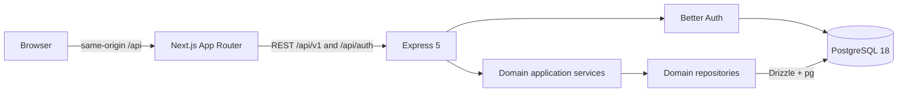

# Implemented architecture

168Hours is a pnpm modular monolith with two independently runnable applications and one PostgreSQL database per environment.

## Workspace boundaries

- `apps/api`: Express composition, identity, categories, planning, goals, nutrition, exercise, hydration, body, dashboard. Routes validate Zod contracts and call services; repositories encapsulate Drizzle persistence.
- `apps/web`: Next.js routes and responsive feature components. TanStack Query owns server-state caching; React Hook Form and Zod handle forms. Native dialogs provide focus trapping and Escape handling. Recharts displays measured weight points. CSS semantic variables use the specification's exact palette.
- `packages/contracts`: Zod inputs, response shapes, and inferred transport types, grouped by domain.
- `packages/api-client`: framework-neutral typed fetch functions, configurable base URL/fetch/headers, common errors. No React or database dependency.
- `packages/domain-utils`: pure Temporal calendar/interval and unit helpers.
- `packages/config`: shared strict TypeScript configuration.

Dashboard composes public services and never reads repositories. Exercise calls Planning's public source-entry methods inside the existing database transaction. Other modules do not depend on Dashboard. Module table imports are allowed for relational foreign keys; private repositories are not imported across domains. The lint command parses imports and enforces domain, route/service/repository, and persistence boundaries. Services receive an opaque transaction scope, which only repositories can resolve to a database transaction. Infrastructure database code and Better Auth’s adapter are explicit persistence exceptions.

## Identity, requests, and isolation

Better Auth uses its transactional Drizzle adapter and UUIDs. It owns users, sessions, credential accounts, and verification records required by the library. An explicit HTTP allowlist exposes email/password signup/signin/signout and session lookup only. The auth boundary validates shared contracts, strips private response fields, and delegates reliable logout to the identity service/repository. Preferences are created lazily and scoped to the authenticated user. See `security.md` for password and session policy.

Every user-owned repository operation includes `user_id`. Supplied category, goal, food, exercise, workout-child, and planned-block references are checked against the same owner. Composite foreign keys reinforce ownership for categories/goals/foods and workout children. Exercise planned-block links have composite owner foreign keys, nullable detach behavior and service checks, allowing plan deletion to retain activity history. Unauthorized resource IDs return the same 404 as missing IDs.

Application and auth mutations require the configured exact Origin and reject cross-site Fetch Metadata. Better Auth retains its own CSRF checks. Cookies are HttpOnly and SameSite=Lax; production configuration requires matching HTTPS web/auth origins and Secure cookies. Auth/private responses are never cached. Protected requests validate sessions against PostgreSQL and forward renewed cookies. Server Components explicitly skip renewal because they cannot write browser cookies. Account transitions reload the document and clear query state so another account cannot inherit the previous account's router/query cache.

Both auth and application payloads are limited to 256 KB. Express bounds raw auth bodies before converting them to a Fetch Request, including chunked transfers; malformed JSON is rejected before invoking the auth library. Application/auth failures share the error envelope. Pino request logs include generated request IDs, method, route template, status, timing, and aborted requests; bodies, credentials, cookies and health records are excluded. Unexpected errors expose no SQL or internal stack to clients. Internal diagnostics retain safe error codes, source locations and causes without raw error messages or database values. Authentication errors preserve 404/429 status and retry guidance. API Helmet and web response headers provide baseline security headers.

Domain mutations pass through a small command service before the domain service. It shares one opaque transaction with persistence and records an owner-scoped idempotency receipt. Required revisions prevent stale edits; successful retries replay the original result. See [write integrity decisions](decisions/003-write-integrity.md) for the HTTP contract, database enforcement and limits.

## Calendar and accounting

Temporal computes local calendar dates, preferred week starts, and UTC day/week bounds. Every interval is clipped to the selected week. Overall allocation is an interval union; category planned totals remain raw durations. Overlap pairs and duplicate duration are explicit. Unknown actual time is null until a record exists.

Manual actual entries remain separate from plans. Explicitly recorded cardio and finished strength workouts each own one unique `(user_id, source_type, source_id)` time entry. Activity updates, completion/reopening, deletion and source accounting share a transaction. Workout writes lock the parent; all Core edits/deletes require the last-seen integer revision. Removing a plan detaches links and preserves historical activity/time.

## Historical data and units

All owned records use UUIDs, UTC timestamps, and owner/time indexes. Local dates (goal targets) remain SQL dates. Food entries snapshot names, servings and nutrients. Workout exercises snapshot names. Definitions are archived instead of deleted. Ordinary logs require confirmation before permanent deletion.

Canonical units are kg, metres, seconds, ml, g and kcal. Conversion happens at input/display boundaries. Unknown nutrient/load/distance values remain null. Nutrition totals carry known sums and unknown-item counts. Weight charts plot only measured points; no synthetic days or health scores exist.

History endpoints use descending `(created_at, id)` keyset pagination with millisecond-precision timestamps. Calendar/daily endpoints are bounded by the selected local period. Dashboard queries are bounded to today/current week and small recent/active summaries.

## Development and verification

Compose separates durable `hours_dev` from ephemeral `hours_test`. Drizzle SQL history is kept in the repository as migration files; no schema push/synchronization is used. Configuration is validated before startup. The API checks schema/connectivity before listening, rejects elevated database roles in production, and uses bounded database waits. Local runtime credentials are separated from migration credentials using `db:provision`. Startup and shutdown failures are logged; draining is idempotent and bounded. `createApp` has no listening side effect, making Supertest integration tests straightforward. Playwright uses dedicated 3100/3101 servers and the isolated test database.

No services, SDKs, scaffolds or adapters for post-Core functionality are present.

General API rate limiting runs before session/database work; health remains available. Express trusts no forwarded IPs by default. Better Auth receives only the address resolved by the API’s configured proxy policy, overriding any supplied internal address header. See `foundation.md` for operational settings and limitations.
