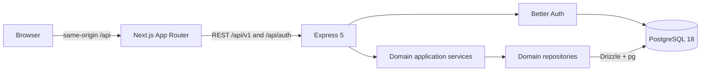

# Implemented architecture

Current presentation scope is the local Calendar/Fitness portfolio. Account access, settings and shared infrastructure are included. Food, Tasks, Programs, Goals, Routines, Templates and Assistant sections below describe retained preview implementations, not default navigation or an active deployment.

Every168 is a pnpm modular monolith with two independently runnable applications and one PostgreSQL database per environment.

## Workspace boundaries

- `apps/api`: Express composition, identity, categories, planning, goals, nutrition, exercise, hydration, body, dashboard. Routes validate Zod contracts and call services; repositories encapsulate Drizzle persistence.
- `apps/web`: Next.js routes and responsive feature components. TanStack Query owns server-state caching; React Hook Form and Zod handle forms. Native dialogs provide focus trapping and Escape handling. Calendar quick actions reuse existing domain and measurement forms; domain history/reporting surfaces remain separate. CSS semantic variables use the specification's exact palette.
- `packages/contracts`: Zod inputs, response shapes, and inferred transport types, grouped by domain.
- `packages/api-client`: framework-neutral typed fetch functions, configurable base URL/fetch/headers, common errors. No React or database dependency.
- `packages/domain-utils`: pure Temporal calendar/interval and unit helpers.
- `packages/config`: shared strict TypeScript configuration.

Dashboard composes public services and never reads repositories. Exercise calls Planning's public source-entry methods inside the existing database transaction. Other modules do not depend on Dashboard. Module table imports are allowed for relational foreign keys; private repositories are not imported across domains. The lint command parses imports and enforces domain, route/service/repository, and persistence boundaries. Services receive an opaque transaction scope, which only repositories can resolve to a database transaction. Infrastructure database code and Better Auth’s adapter are explicit persistence exceptions.

Reusable Strength plans also carry an `isDraft` state. Shared contracts permit incomplete drafts while requiring a title, exercises and sets for ready workouts. The Exercise service resolves every referenced exercise for the owner, stores canonical name snapshots and rejects draft start/schedule operations; the repository persists the state with the existing revision/idempotency protections. Drafts appear in the same saved-workout list, separate from scheduled instances and actual sessions.

Training programs belong to Exercise. A program stores ordered stable step identities and owner-validated reusable workout references; each acted-on occurrence stores cycle/position/title/date and an owner-constrained link to an independent Strength plan snapshot. The latest occurrence and canonical session completion determine the next step; no duplicate completion flag or new Calendar activity source is introduced. Program commands lock/revise the parent and validate the expected sequence, with idempotent receipts. Calendar time is created, moved and removed through Planning’s public service and checked against the reviewed block revision. Preferred weekdays use Identity’s timezone and calendar-date arithmetic. Source definitions are locked in stable ID order; program/occurrence repositories own persistence. Deleting programs cascades their occurrence history but retains independent sessions/plans/Calendar blocks. Migration 0028 adds both tables, ownership constraints, sequence uniqueness and revision triggers.

Fitness progress is a read-only projection of canonical Strength records. Its public service obtains timezone/week-start preferences from Identity, validates owned exercise/workout references, and delegates aggregation to the Exercise module’s progress repository. The UI requests only its visible week (two aggregates); bounded optional multi-week reads retain their API compatibility. Weekly totals and per-exercise records/history use repeatable-read snapshots; history pages are ordered by `(started_at, id)` rather than entry creation time. Completed actual sets from finished workouts qualify; captured tracking types separate metrics, and known load × reps volume carries missing-measurement counts. Personal records retain source workout/set references and deterministic earliest-date tie handling. Workout comparison matches the multiset of exercise identities and captured modes, with repeated occurrences paired in occurrence order; current, matching and prior reads share one repeatable-read snapshot. Existing Fitness cache invalidation refreshes reports after writes; no statistics table, scheduled job or new Calendar time source is introduced.

## Identity, requests, and isolation

Better Auth uses its transactional Drizzle adapter and UUIDs. It owns users, sessions, credential accounts, and verification records required by the library. An explicit HTTP allowlist exposes email/password signup/signin/signout and session lookup only. The auth boundary validates shared contracts, strips private response fields, and delegates reliable logout to the identity service/repository. Preferences are created lazily and scoped to the authenticated user. See `security.md` for password and session policy.

Every user-owned repository operation includes `user_id`. Supplied category, goal, food, exercise, workout-child, and planned-block references are checked against the same owner. Composite foreign keys reinforce ownership for categories/goals/foods and workout children. Exercise planned-block links have composite owner foreign keys, nullable detach behavior and service checks, allowing plan deletion to retain activity history. Unauthorized resource IDs return the same 404 as missing IDs.

Application and auth mutations require the configured exact Origin and reject cross-site Fetch Metadata. Better Auth retains its own CSRF checks. Cookies are HttpOnly and SameSite=Lax; production configuration requires matching HTTPS web/auth origins and Secure cookies. Auth/private responses are never cached. Protected requests validate sessions against PostgreSQL and forward renewed cookies. Server Components explicitly skip renewal because they cannot write browser cookies. Account transitions reload the document and clear query state so another account cannot inherit the previous account's router/query cache.

Both auth and application payloads are limited to 256 KB. Express bounds raw auth bodies before converting them to a Fetch Request, including chunked transfers; malformed JSON is rejected before invoking the auth library. Application/auth failures share the error envelope. Pino request logs include generated request IDs, method, route template, status, timing, and aborted requests; bodies, credentials, cookies and health records are excluded. Unexpected errors expose no SQL or internal stack to clients. Internal diagnostics retain safe error codes, source locations and causes without raw error messages or database values. Authentication errors preserve 404/429 status and retry guidance. API Helmet and web response headers provide baseline security headers.

Domain mutations pass through a small command service before the domain service. It shares one opaque transaction with persistence and records an owner-scoped idempotency receipt. Required revisions prevent stale edits; successful retries replay the original result. See [write integrity decisions](decisions/003-write-integrity.md) for the HTTP contract, database enforcement and limits.

## Calendar and accounting

The web landing route is Calendar, with Day, Week (default), and Month views. The feature coordinator delegates bounded data loading to a calendar hook, controls to the toolbar, presentation to month/time grids, and writes to the existing editor. Month composes four to six existing owner-scoped week reads, each under the shared week cache prefix; it never sums them into invented month totals or treats a failed row as empty. Date helpers calculate only navigation/visible rows; grid geometry is presentation-only. Canonical totals remain in the API. Calendar is a general planning surface; it no longer mounts domain panels or fetches Dashboard. Preview selected-date quick actions retain water and weight logging; core Calendar Add offers plans and the public Fitness scheduling provider. The removed cross-domain panel components and styles are deleted; backend services and the shared API remain intact. Core AppShell exposes Calendar, Fitness and the account disclosure; preview also exposes the retained deferred workspaces. The old Food/Exercise interfaces remain retired; the current Fitness and Everyday Food workspaces use the retained Exercise and Nutrition modules through their public APIs. Unscheduled, Routines and Goals pages and dedicated APIs require preview scope. Shared core searches and Calendar ranges exclude unscheduled items before pagination. URL state identifies calendar dates/views. See [UI standards](ui-standards.md).

Calendar's shared day-record list serves Week overflow and Month. Small presentation helpers handle clipping, quarter-hour selection, local draft times and elapsed-duration moves; the page owns ephemeral scroll memory. Duplication reuses the existing block-create contract and copies only editable plan fields into a draft. Shared forms retain request keys and captured revisions, and native dialogs restore keyboard focus. A pointer interaction provider owns drag previews, cancellation, auto-scroll and retry-safe adjustments; forms remain the keyboard and precise-time alternative. No drag library or background worker is required.

The Planning module now has focused services/repositories for date-only items, finite repeating series, copy/templates, and history search. Four owned tables extend PostgreSQL: `calendar_items`, `calendar_series`, `calendar_templates`, and normalized `calendar_template_entries`. Materialized recurring blocks remain ordinary time blocks with stable occurrence identity. Parent revisions advance with child changes. All new endpoints use the existing shared contracts, write receipts, owner checks and transaction scopes. Month command inputs deduplicate cross-week block identities without removing continuation rendering. Saved unchanged local clock fields retain exact instants through DST edits. A tab/account-specific Calendar request journal retains unresolved ordinary plan writes across refresh, while Undo/Redo retains its separate canonical pending-command state. Calendar reads date-only items alongside bounded week queries; filters do not change canonical accounting or linked-record metadata. Search merges bounded owner-scoped reads with a `(created_at, id, kind)` cursor. See [Calendar decisions](decisions/004-calendar-expansion.md).

Temporal computes local calendar dates, preferred week starts, and UTC day/week bounds. Every interval is clipped to the selected week. Overall allocation is an interval union; category planned totals remain raw durations. Overlap pairs and duplicate duration are explicit. Unknown actual time is null until a record exists.

Manual actual entries remain separate from plans. Explicitly recorded cardio and finished strength workouts each own one unique `(user_id, source_type, source_id)` time entry. Activity updates, completion/reopening, deletion and source accounting share a transaction. Workout writes lock the parent; all Core edits/deletes require the last-seen integer revision. Removing a plan detaches links and preserves historical activity/time.

Workout corrections retain validated child IDs and creation timestamps, keeping ordinary edits stable in paginated progress history. Completed-set progress and its maximum load share one read snapshot. Exercise restoration and history filters use the same owner/revision/contract boundaries. The browser captures generated finish timestamps per request key and invalidates all affected Calendar caches. See [Exercise decisions](decisions/006-exercise-slice.md).

## Historical data and units

Food's daily page composes Nutrition, Hydration and Body through their typed public APIs; these remain separate backend domains. Nutrition provides entry, meal and daily values from the same immutable snapshots, plus literal-name history search and versioned food restoration. Hydration returns daily records and totals from one read. Body provides a consistent selected-day/latest/30-day review under a read-only repeatable-read transaction, with a 200-point chart limit and paginated full history. Only presentation and unit formatting live in the web. See [Food decisions](decisions/005-food-slice.md).

All owned records use UUIDs, UTC timestamps, and owner/time indexes. Local dates (goal targets) remain SQL dates. Food entries snapshot names, servings and nutrients. Workout exercises snapshot names. Referenced custom definitions are archived to preserve history; unused custom exercises may be deleted. Built-in exercise definitions stay read-only. Ordinary logs require confirmation before permanent deletion.

Canonical units are kg, metres, seconds, ml, g and kcal. Conversion happens at input/display boundaries. Unknown nutrient/load/distance values remain null. Nutrition totals carry known sums and unknown-item counts. Weight charts plot only measured points; no synthetic days or health scores exist.

History endpoints use stable keyset pagination with millisecond-precision timestamps: workout history follows `(started_at, id)`, while definition/list endpoints use their contract-defined creation keys. Calendar/daily endpoints are bounded by the selected local period. Dashboard queries are bounded to today/current week and small recent/active summaries.

## Development and verification

Verification remains available locally through `pnpm verify` and the core `pnpm verify:beta` gate. The [GitHub Actions workflow](../.github/workflows/ci.yml) runs quality checks and a separate sequential PostgreSQL integration/production-build/beta-browser job; see [verification](verification.md#github-actions).

Compose separates durable `hours_dev` from ephemeral `hours_test`. Drizzle SQL history is kept in the repository as migration files; no schema push/synchronization is used. Configuration is validated before startup. The API checks schema/connectivity before listening, rejects elevated database roles in production, and uses bounded database waits. Local runtime credentials are separated from migration credentials using `db:provision`. Startup and shutdown failures are logged; draining is idempotent and bounded. `createApp` has no listening side effect, making Supertest integration tests straightforward. Playwright uses dedicated 3100/3101 servers and the isolated test database.

No AI SDK, native client, distributed worker or additional network service is present. Retained preview domains use the same backend and explicitly gated public entry points.

General API rate limiting runs before session/database work; health remains available. Express trusts no forwarded IPs by default. Better Auth receives only the address resolved by the API’s configured proxy policy, overriding any supplied internal address header. See `foundation.md` for operational settings and limitations.

## Admin extension

Identity contains fixed account types and the Admin routes/service/repository. Its account metadata and audit reads are explicitly authorized cross-account operations guarded by fresh admin checks. Aggregate domain counts pass through public services; personal endpoints retain user ownership regardless of account type. Shared Admin contracts and a typed client back the responsive `/admin` page. PostgreSQL reinforces immutable types, suspension/session serialization, management revisions and append-only audit history. A local interactive command creates new Admin accounts atomically. No role mutation endpoint exists. See [Admin decisions](decisions/007-admin.md).

Admin deletion uses the Identity service/repository and existing owner-cascade foreign keys. Shared contracts carry email confirmation and revision/idempotency headers. The acting Admin owns the retry receipt; immutable audit identifiers have no account foreign keys. Account, cascade, audit and receipt changes commit atomically.

## Calendar activity

Planning composes registered public domain activity providers into a common read contract. Domain services own presentation metadata; their repositories own scoped occurrence-range reads. No separate feed persistence is introduced. The web day feed merges plans/manual time with source projections and deduplicates exercise accounting entries by source identity. Moment markers carry no duration. Shared contracts and API client keep the wire boundary independent of API/Drizzle internals. See [Calendar activity decisions](decisions/008-calendar-activity.md).

## Planned product direction

The owner-authorized Assistant preview lives in the authenticated client shell. It uses page/date labels and account-scoped component memory only, with no AI client, backend endpoint, record-context fetching or domain execution. An account-keyed Assistant provider shares draft text, popup geometry and captured page/date/return metadata between the dedicated /assistant route and quick-chat popup. Popup use preserves the mounted domain workspace; route handoff uses normal guarded navigation and existing workout recovery. A launcher can be portalled into native modal editors so quick chat remains reachable; no domain records are copied into the provider.

The [product scope](SCOPE.md) defines the current roadmap, separately from the implemented architecture above. Calendar is the shared overview; built-in domains own detailed workflows and ongoing logging. Future AI should consume relevant user-owned domain context and use defined domain operations, keeping suggestions, accepted plans and recorded activity distinct. Later mobile and desktop clients share the same backend, contracts and canonical business rules while adapting their interfaces to the device. Custom domains are deferred until after those priorities and before a stretch-goal watch app. These future capabilities do not require adding speculative modules, client scaffolds or generic tracker infrastructure now.

## Fitness workouts

The Exercise module owns `strength_plans` for reusable workouts and scheduled snapshots, along with existing sessions and sets. Shared contracts distinguish target values from actual results and unfinished/completed/skipped sets. Strength-plan services validate owner-scoped exercise references, create Calendar time through Planning's public service, and start sessions atomically. Scheduled starts resume an existing session; reusable starts create independent sessions. Existing source-time services provide unique recorded Calendar time. Calendar source-link receipts also capture and restore scheduled-plan links through deletion/undo.

The web exposes `/fitness`, reusable workout editors and session pages. Focused components own the library, exercise/set fields, scheduling and rest timer. Session writes debounce through revision-checked commands with same-key retry; account/session-scoped tab storage keeps recovery drafts. Conflicting drafts require explicit discard. Next.js uses only shared contracts and the API client.

The Fitness workspace composes exercise browsing, contextual details, workout actions and recent history from focused frontend components. Static built-in definitions remain canonical and read-only. A catalogue key identifies the shared definition; lazily created owner-scoped exercise identities let built-ins use the same existing workout references/history as custom exercises. Repository projections always resolve built-in core fields from the catalogue. Custom definitions remain private. `exercise_preferences` stores account favourites and built-in visibility separately; a revision-checked preference write advances the exercise revision in the same transaction. Built-in definition writes are rejected by public services and a database trigger. Duplication creates an independent custom definition without copying history or preferences. Unused custom deletion locks the definition before checking saved/scheduled JSON references and workout references; ordinary reference reads take shared locks, preventing concurrent deletion from producing orphaned plans. No API internals enter the web client.

Fitness uses a persistent Next layout with Training, Exercises and History routes. Training shows reusable workouts and drafts; Programs require preview scope. Exercises owns the searchable library and contextual details/history. The shared workout editor puts the draft beside its exercise library on desktop and uses explicit workout/library views on narrow screens. Reusable preparation, session-only editing and recorded-result correction reuse editor controls with context-specific save/lifecycle behavior. The normal Live view focuses on logging the current set and rest, not the full editor. Contextual navigation retains opener, measurement selections, focus and scroll without indefinitely nesting return links.

Exercise measurements are independently selectable Reps, Weight, Duration, Distance and Laps. The existing `loggingType` field encodes each nonempty selection as a canonical shared key rather than a user-facing preset. A per-set override can replace the captured exercise selection without clearing hidden values. Reusable workouts, scheduled snapshots and sessions preserve their own selections and targets. Legacy Strength route/table/source names remain internal identifiers for this general workout flow. Intent tags remain in retained storage/contracts but are not part of the current UI. No new rest or schedule time source is introduced.

## Everyday Food

Nutrition owns food definitions, saved meals and recipes in `foods`, with a kind, favourite flag, instructions, yield and bounded ingredient snapshots. A recipe references owned active foods; a meal can also reference recipes, avoiding recursive dependency graphs. Services read ingredient definitions under shared locks in stable ID order and calculate nullable per-portion nutrition canonically. Saved preparation snapshots remain independent; saving edits refreshes ingredients. Logging accepts bounded ingredient-quantity overrides against the reviewed definition revision, stores the whole preparation as one `food_entries` snapshot and emits one Calendar moment. Repeat retains that snapshot, while ordinary logging captures the current definition. Quick entries omit a library reference. Calories are nullable just like other nutrients. Migration 0030 extends both existing tables and their constraints; revision triggers and owner foreign keys remain in force.

The Food route uses shared contracts/client APIs only. Focused components handle the daily coordinator, library, preparation/food editors, picker, entry forms/history and nutrition formatting. Existing measurement panels/forms retain Hydration and Body ownership. Forms retain request payloads/keys during uncertain writes, block dismissal while pending, protect unsaved edits and reject stale revisions. Food writes invalidate nutrition, library, Calendar activity and dashboard reads; no meal planning, new time sources or background tasks are introduced.

## Shared domain day context

Food, Fitness and Tasks compose `DomainDayPanel` from the existing Calendar date picker, feed, bounded reads and semantic styles. The authenticated shell owns selected-day context; explicit valid URL dates take precedence and date changes preserve the current route/query. Domain adapters identify activity sources, actions and genuine planned links. Each domain places the same full-height Day rail beside its main content without a domain title bar; narrow screens reuse the Day drawer. Fitness has Training, Exercises and History within its persistent workspace. The shared workout editor substitutes its exercise library for the Day rail, while normal training/review surfaces retain selected-day context. Library filters and mounted workout drafts are preserved. Calendar itself keeps its full workspace rather than mounting an extra domain panel.

Fitness exposes a read-only `strength-plans/day-links?date=` contract. Its service uses Planning's public timezone-aware week projection to identify the selected day's blocks, then one owner-scoped Exercise repository lookup returns only scheduled-workout links. Matching titles never imply membership. Existing Calendar/Fitness invalidation refreshes these links after scheduling, moving or deleting plans. No new storage or writes are introduced. Programmatic source navigation participates in the same unsaved-change guard as ordinary links.

## Everyday Tasks

Tasks owns tasks, projects, schedule links and time records in a dedicated module with shared contracts/client functions and thin authenticated routes. Its service validates owned project/section references and serializes account-local task mutations. Revisions and idempotent receipts protect writes; a unique recurrence key/date and the resolved occurrence's advancement flag prevent duplicate successors. Date-only recurrence retains monthly anchors and completed snapshots without workers or a generic recurrence engine.

Planning's public services create/move/delete reservations and upsert one `task_time` ledger entry per actual-time record. Tasks never writes Planning tables directly. Source-link capture/restore preserves unchanged reservations through Calendar undo. Calendar activity composes dated task plans, completion moments and actual work; the Day feed renders dated tasks as Any time and deduplicates actual-time accounting records. Existing Calendar cache invalidation refreshes Tasks links; Tasks writes refresh shared Calendar reads. The Tasks UI reuses authenticated selected-day context, the shared panel and canonical Routines through their existing public APIs.

### Workout creation preview

The owner is trialling a reversible draft-left/library-right layout for reusable workout creation and editing. Hide the Day panel in this workspace. Keep top-level Fitness tabs fixed above independently scrolling workout and library panes, with save actions pinned beneath workout content; mobile switches between Your workout and Add exercises. Compact controls set the set count and shared optional targets, with Advanced editor retaining individual targets and advanced fields. Existing data formats, draft recovery and save commands remain canonical. `workoutCreationExperiment` controls the trial; sessions retain their inline picker and Day panel.

### Independent Fitness measurements

The shared contract defines five independent measurement fields and a canonical key for each nonempty selection. The existing loggingType wire/storage field encodes this selection in deterministic order for exercise defaults, plan/session snapshots, draft recovery and history matching; it is no longer a fixed UI preset. Shared measurement helpers drive selection and presentation. Progress services and repository queries test field membership, including volume when reps and load are both selected. Hidden values remain stored. Migration 0033 expands the allowed keys and allows known load-only completed sets.

### Per-set measurement overrides

Planned and recorded sets accept nullable measurementOverride, using the shared canonical selection keys. Null or omission inherits the exercise snapshot’s loggingType; an explicit override remains independent when defaults change. Strength set persistence stores the override; JSON plan/program snapshots and draft recovery retain it. Reports use coalesce(set.measurementOverride, exercise.loggingType) for membership and filtering; source set position preserves numbering in filtered history. Comparisons include override patterns in matching and aggregate selected fields per set. Migration 0034 adds the nullable column and selection constraint.

Advanced workout presentation is derived from saved per-set settings rather than a persisted view flag. workout-basic-settings identifies overrides/differing planned targets/rest and builds an independent reset proposal. ResetWorkoutExercise confirms applying the deterministic shared-value proposal as one draft change; it never directly writes to the API. Matching set selections normalise to null inheritance in shared contract helpers, UI editing and canonical plan/session writes.

Public-beta account lifecycle uses hashed single-use verification/reset tokens in existing Identity verification storage and revokes sessions after password changes/reset. Production HTML is dynamically rendered with fresh script nonces and a restrictive CSP; inline style support remains for Calendar geometry. PUBLIC_BETA_DEPLOYMENT.md preserves earlier deployment assumptions and acceptance requirements; actual public deployment is now deferred. LOCAL_DEVELOPMENT.md documents the supported local and isolated showcase paths.
