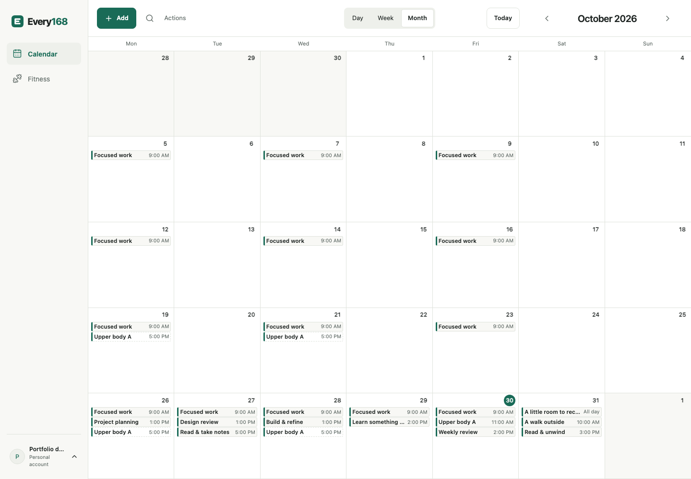
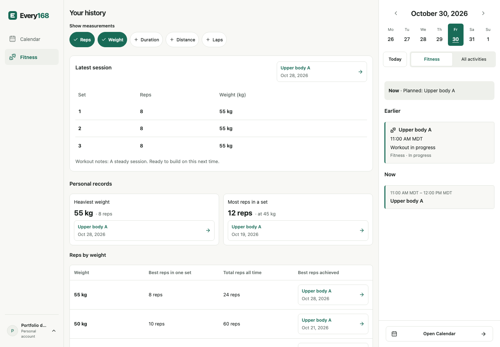
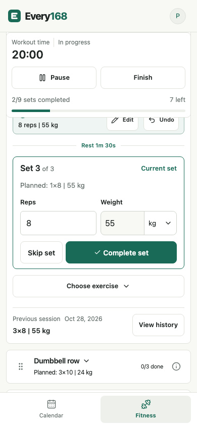

# Application screenshots

These are genuine browser captures of the local Every168 application, using synthetic records created through its real API. They do not show the owner's account, real activity or a deployed service. No generated illustration is used as an application screenshot.

## Gallery

| View                      | Capture                                                                |
| ------------------------- | ---------------------------------------------------------------------- |
| Sign in                   | [sign-in.png](screenshots/sign-in.png)                                 |
| Calendar Week             | [calendar-week.png](screenshots/calendar-week.png)                     |
| Calendar Month            | [calendar-month.png](screenshots/calendar-month.png)                   |
| Editing a plan            | [plan-editor.png](screenshots/plan-editor.png)                         |
| Exercise library          | [exercise-library.png](screenshots/exercise-library.png)               |
| Workout builder           | [workout-builder.png](screenshots/workout-builder.png)                 |
| Live workout              | [live-workout.png](screenshots/live-workout.png)                       |
| Completed summary         | [workout-summary.png](screenshots/workout-summary.png)                 |
| Exercise progress/history | [exercise-history.png](screenshots/exercise-history.png)               |
| Responsive live workout   | [live-workout-responsive.png](screenshots/live-workout-responsive.png) |

### Calendar Month



### Exercise history



### Responsive browser layout



## Reproduce

```bash
pnpm install --frozen-lockfile
pnpm db:up
pnpm exec playwright install chromium
pnpm portfolio:capture
```

See [local development](../LOCAL_DEVELOPMENT.md#provider-free-showcase) for interactive recording mode. Capture code: [fixture and browser flow](../../tests/portfolio/capture.spec.ts), [configuration](../../playwright.portfolio.config.ts).

- Capture date: 2026-10-30, recaptured after the Every168 rebrand. All ten frames are genuine application captures, including the account-access screen.
- Desktop: Chromium, 1440×1000 CSS pixels, device scale 1.
- Responsive view: the same browser at 390×844 CSS pixels; this is viewport testing, not a native app or physical-phone claim.
- Light theme, English locale, America/Edmonton account/browser timezone.
- A fixed October 2026 clock and synthetic record dates make the scene reproducible. Random account/record IDs are not displayed as user data.
- After capture, the simulated clock advances again so an interactive recording can show working timers. Both fixture servers bind to loopback.
- The existing test-only server captures verification email in memory; no external message is sent. Development data is not queried or reset.
- API responses and application DOM content are not replaced for presentation. Captures wait for real records to load. Animations are disabled by Playwright for settled frames.

## Provenance and licensing

The application source and project documentation use the existing [MIT license](../../LICENSE). The Every168 E mark is an original geometric project asset; its wordmark uses the same system sans-serif family as the interface. Source vectors, generated app icons and reproduction are documented in the [brand guide](../BRAND.md). No third-party exercise illustration or bundled font file was found in the repository; the exercise visuals are explicitly labelled placeholders.

UI icons come from Lucide (`lucide-react`), with ISC terms and MIT terms for Feather-derived icons. Their complete installed notice is retained in [LUCIDE-LICENSE.txt](LUCIDE-LICENSE.txt) alongside these screenshots. Other dependencies retain their own package licenses; node_modules and compiled vendor bundles are not committed as portfolio assets.

Do not assume the project's MIT license grants rights to future artwork or external catalogue imagery. Review source and redistribution rights before adding those assets. No current artwork was relicensed in this pass.

A broader license inventory was attempted with `pnpm licenses list --prod`, but the local package store reported missing package-index metadata. A fallback inspected 631 installed name/version metadata entries, including build/test tools and retained package versions. In addition to permissive licenses, that tree includes MPL-2.0 tools, LGPL-3.0-or-later native libvips packages and CC-BY-4.0 compatibility data. This is metadata evidence, not an assertion that every dependency or binary can be relicensed as MIT. No dependency tree or native/vendor binary is redistributed by this screenshot/source presentation.
